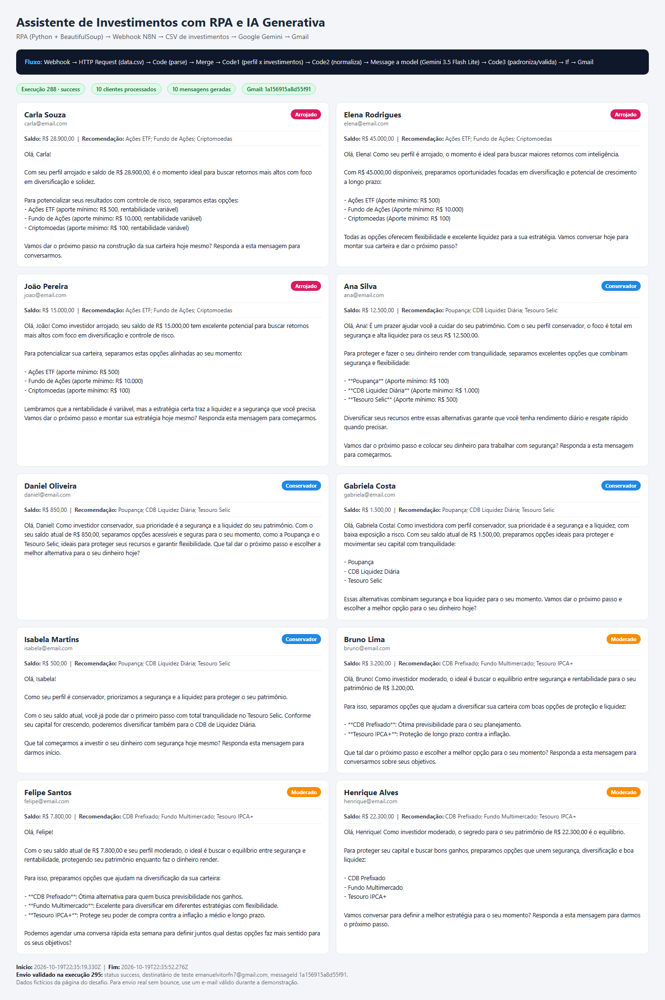

# Demonstração

## Execução 288 — geração das mensagens (10 clientes)

- Workflow: `DIO TESTE FINAL`
- Status: `success`
- Clientes processados: 10
- Modelo: `models/gemini-3.5-flash-lite`
- Resultado: 10 mensagens personalizadas geradas a partir do perfil, saldo e investimentos recomendados.

## Envio real pelo Gmail — execução 295

- Status: `success`
- Destinatário de teste: `emanuelvitorfn7@gmail.com`
- `messageId`: `1a156915a8d55f91`
- Tempo aproximado: 4 s

## Print da execução

## Como reproduzir

1. Importe `n8n/workflow.json` no N8N.
2. Selecione as credenciais do **Google Gemini** e do **Gmail** (o Gmail é opcional).
3. Ative o workflow e confirme o Webhook em `POST /webhook/clientes`.
4. Execute `src/extrair_clientes.ipynb` (local ou Colab), ajustando `N8N_WEBHOOK` se necessário.
5. O notebook mostra os clientes extraídos e a resposta do N8N.

## Observações

- Os e-mails da página do desafio são fictícios (`ana@email.com`, etc.) e podem gerar bounce. Para uma demonstração real, use um e-mail válido.
- O arquivo `n8n/workflow.json` foi exportado sem credenciais; elas devem ser selecionadas após a importação.
- A mensagem estática por perfil é montada no `Code2` (`mensagem_base`) e serve como base/fallback para a versão gerada pelo Gemini.
